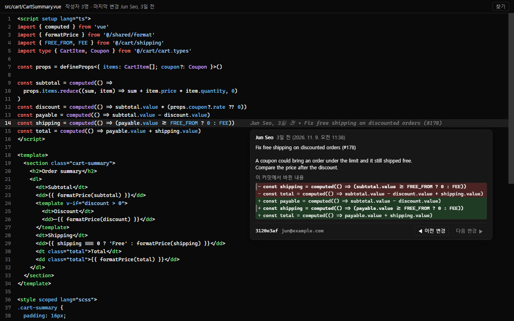
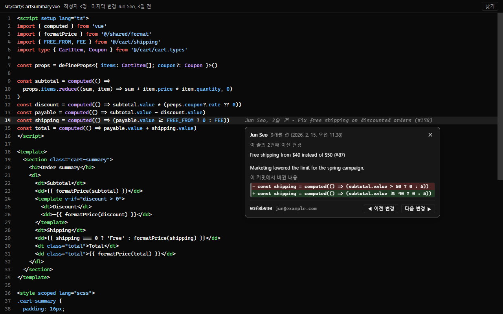
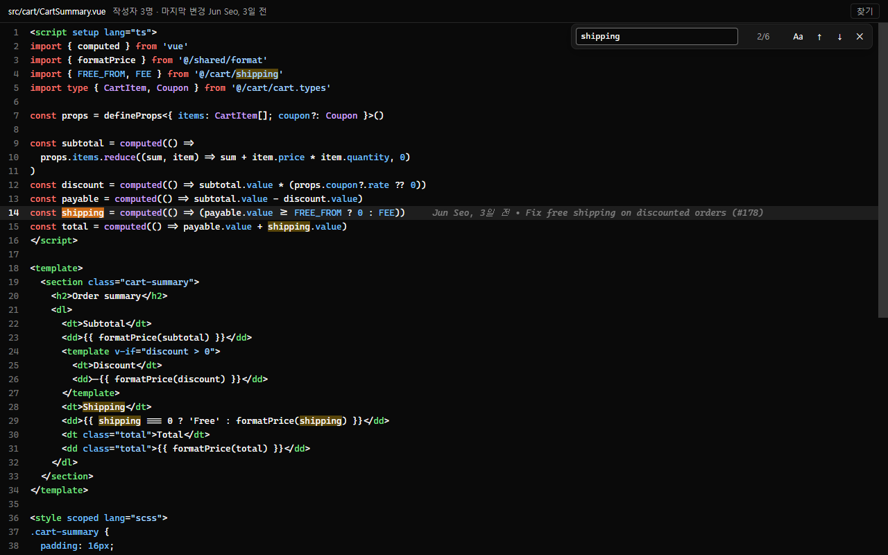

# Line Blame

코드 한 줄을 누가, 언제, 왜 고쳤는지 [Orca](https://orca.dev) 안에서 바로 확인합니다.

줄을 클릭하면 그 줄 끝에 답이 나옵니다. VS Code의 GitLens와 같은 방식입니다. 읽기 전용이라 코드를 고치는 용도가 아니라, 문제가 언제 들어왔는지 찾는 용도입니다.

[English](README.md)



## 할 수 있는 것

**1. 누가 고쳤는지 보기.** 아무 줄이나 클릭하세요. 줄 끝에 작성자, 얼마 전인지, 커밋 제목이 나옵니다.

**2. 그 커밋이 뭘 바꿨는지 보기.** 그 글씨에 마우스를 올리세요. 커밋 메시지 전체와, 그 줄의 변경 전·후가 카드로 나옵니다.

**3. 과거로 거슬러 가기.** 카드의 **◀ 이전 변경**을 누르면 그 줄을 그 전에 고친 커밋이 나옵니다. 계속 누르면 그 줄이 처음 만들어진 커밋까지 갑니다.



**4. 파일 안에서 찾기.** Ctrl+F 또는 **찾기** 버튼을 누르세요. 결과 사이를 이동하면 그 줄의 정보가 바로 보입니다.



## 설치

1. Orca에서 **설정 → 플러그인 → 플러그인 설치 → Git URL에서…** 를 엽니다.
2. `yeonjin1357/orca-line-blame`을 입력하고 설치합니다.
3. 권한 확인 창에서 **플러그인 활성화**를 누릅니다.

터미널에서 아래 명령을 실행하고 안내를 따라도 됩니다.

```sh
orca plugin install yeonjin1357/orca-line-blame
```

Orca 1.4.248 이상과 git이 필요합니다.

## 사용

평소처럼 파일을 연 뒤, 편집기의 보기 전환에서 **소스** 옆의 **Blame**을 고릅니다. 파일을 고치려면 다시 **소스**로 돌아가면 됩니다.

## 지원하는 파일

거의 모든 소스·텍스트 파일에서 쓸 수 있습니다. 모두 230가지쯤 됩니다.

- **웹:** Vue, Svelte, Astro, React(`.jsx`, `.tsx`), TypeScript, JavaScript, HTML, CSS, SCSS, Less
- **언어:** Python, Java, Kotlin, Scala, Go, Rust, C, C++, C#, Swift, Ruby, PHP, Dart, Elixir, Haskell 등
- **스크립트·데이터:** 셸, PowerShell, SQL, GraphQL, Protobuf
- **설정·문서:** JSON, YAML, TOML, XML, Markdown, `Dockerfile`, `Makefile`, `.gitignore`

대부분 문법 색상이 입혀집니다. Zig, Terraform 같은 몇 가지는 색 없이 나오지만 기록 조회는 똑같이 됩니다.

Orca에는 "모든 파일"을 한 번에 지정하는 방법이 없어서 파일 종류를 하나씩 등록했습니다. 빠진 게 있으면 [이슈](https://github.com/yeonjin1357/orca-line-blame/issues)로 알려 주세요.

## "전체 액세스" 경고에 대해

설치할 때 Orca가 이 경고를 보여줍니다. Line Blame이 git을 실행하려고 별도 프로그램을 띄우기 때문입니다. 이 프로그램은 조회만 하는 git 명령(`blame`, `diff`, `show`, `status`, `ls-files`)만 실행합니다. 파일이나 저장소를 바꾸지 않고, 네트워크로 아무것도 보내지 않습니다.

## 알아둘 점

- **내용이 같은 파일이 둘 이상일 때.** Orca는 플러그인에 어떤 파일이 열렸는지 알려주지 않아서, Line Blame은 파일 내용으로 파일을 찾습니다. 내용이 똑같은 파일이 여러 개면 화면 위쪽에서 맞는 파일을 골라 주세요.
- **"이전 변경"은 추정입니다.** git은 예전 어느 줄이 지금 어느 줄이 됐는지 기록하지 않습니다. 그래서 가장 비슷한 줄을 따라갑니다. 완전히 새로 쓴 줄에서는 엉뚱한 줄을 따라갈 수 있습니다.
- **언어.** Orca가 한국어면 한국어로, 그 외에는 영어로 나옵니다.
- **로컬 워크스페이스만 지원합니다.** git은 Orca가 실행 중인 컴퓨터에서 돌아갑니다.

스크린샷에 나온 코드는 실제 프로젝트가 아니라 예시로 만든 것입니다.

## 라이선스

MIT ([LICENSE](LICENSE)). 문법 색상은 [highlight.js](https://highlightjs.org/)(BSD-3-Clause), 아이콘은 [Lucide](https://lucide.dev)의 "git-commit-horizontal"(ISC)을 사용했습니다.
