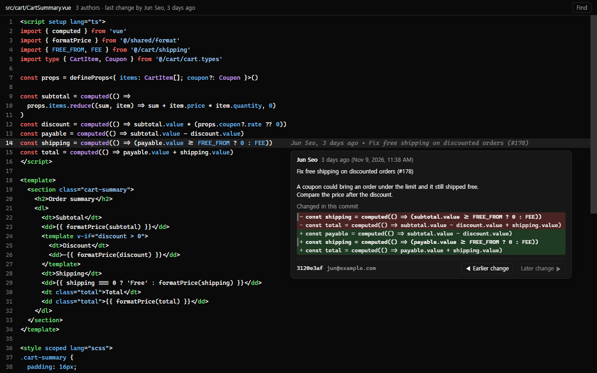
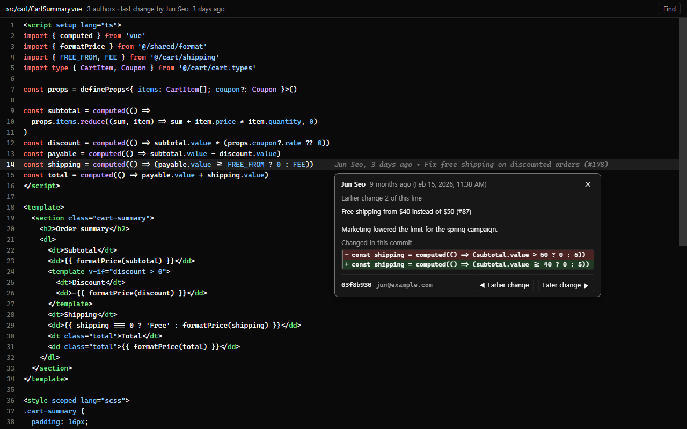
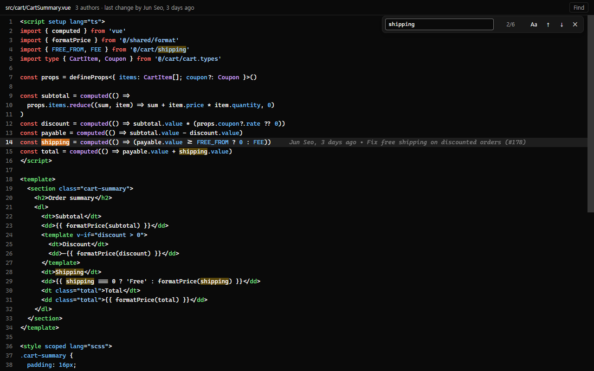

# Line Blame

See who changed a line of code, when and why, without leaving [Orca](https://orca.dev).

Click a line and the answer appears at the end of it, the way GitLens shows it in VS Code. The view is read-only: it is for finding out when a problem got in, not for editing.

[한국어 안내](README.ko.md)



## What you can do

**1. See who changed a line.** Click any line. Its author, how long ago and the commit title appear at the end of the line.

**2. See what that commit changed.** Hover over that text. A card shows the whole commit message, and the line before and after the change.

**3. Go back in time.** Press **◀ Earlier change** in the card to see the commit that changed the line before that. Keep pressing to reach the commit that first wrote the line.



**4. Find in the file.** Press Ctrl+F or the **Find** button. As you move between matches, each line shows its blame.



## Install

1. In Orca, open **Settings → Plugins → Install plugin → From a Git URL…**
2. Enter `yeonjin1357/orca-line-blame` and install.
3. Press **Enable plugin** in the approval window.

Or run this in a terminal and follow what it prints:

```sh
orca plugin install yeonjin1357/orca-line-blame
```

It needs Orca 1.4.248 or later, and git.

## Use

Open a file as usual, then pick **Blame** in the editor's view switch, next to **Source**. To edit the file, switch back to **Source**.


## Supported files

Almost any source or text file, about 230 file types in all:

- **Web:** Vue, Svelte, Astro, React (`.jsx`, `.tsx`), TypeScript, JavaScript, HTML, CSS, SCSS, Less
- **Languages:** Python, Java, Kotlin, Scala, Go, Rust, C, C++, C#, Swift, Ruby, PHP, Dart, Elixir, Haskell and more
- **Scripts and data:** shell, PowerShell, SQL, GraphQL, Protobuf
- **Config and docs:** JSON, YAML, TOML, XML, Markdown, `Dockerfile`, `Makefile`, `.gitignore`

Most are syntax-coloured. A few, such as Zig and Terraform, are shown as plain text; blame works the same.

Orca has no "every file" option, so each file type is listed by hand. If yours is missing, [open an issue](https://github.com/yeonjin1357/orca-line-blame/issues).

## About the "Full access" warning

Orca shows this warning when you install the plugin, because Line Blame starts its own program to run git. That program only runs git commands that read (`blame`, `diff`, `show`, `status`, `ls-files`). It never changes your files or your repository, and it sends nothing over the network.

## Good to know

- **Two files with the same content.** Orca does not tell a plugin which file is open, so Line Blame finds the file by its content. If two files are identical, pick the right one at the top of the view.
- **"Earlier change" is a best guess.** Git does not record which old line became which new line, so the plugin follows the most similar one. For a line that was rewritten from scratch it can follow the wrong line.
- **Language.** The view is in Korean when Orca is, and in English otherwise.
- **Local workspaces only.** Git runs on the computer Orca runs on.
- **Repositories inside a workspace.** A repository cloned into a workspace folder, or a submodule, is searched too, up to two folders deep.

<details>
<summary>For contributors</summary>

```sh
orca plugin test .          # tests; the worker tests run real git in throwaway repositories
orca plugin check .         # static check of the editor
orca plugin dev load .      # load this folder into Orca (the first time needs --approve)
orca plugin dev reload .    # after a change
```

Every push to `main` and every pull request also runs the tests on macOS, Linux and Windows (`.github/workflows/tests.yml`). Those machines have no Orca, so the tests are bundled with `tools/orca-testing-stand-in.mjs` in place of `orca/testing`; `orca plugin test .` on your own machine stays the reference.

Orca loads `.ts` files as written and never type-checks them. Run `tsc -p .` from a place that has `typescript` and `@types/node`; this repository keeps no `node_modules`.

| Path | What it holds |
| --- | --- |
| `src/worker.ts` | The background program: answers the view's requests and checks their input |
| `src/locate.ts` | Finding which file an open text belongs to |
| `src/repositories.ts` | Finding repositories that sit inside a workspace |
| `src/blame.ts` | Reading `git blame --porcelain` |
| `src/change.ts` | Reading `git diff -U0`: what a commit did to one line and which line it replaced |
| `src/protocol.ts` | The types the view and the background program exchange |
| `editor/main.ts` | The view: code lines, the blame text, the summary bar |
| `editor/card.ts` | The commit card and stepping through a line's history |
| `editor/find-bar.ts`, `editor/find.ts` | Find in file |
| `editor/messages.ts` | Everything the view says, in Korean and in English |
| `editor/highlight.ts` | Syntax colours, with highlight.js: which language each file type is coloured as |
| `tools/build-grammars.cjs` | Rebuilds `editor/vendor/highlight-languages.min.js`, the grammars highlight.js's common build leaves out |

To add a file type, list it in one of the `customEditors` groups in `orca-plugin.json`, then give it a language in `editor/highlight.ts` if highlight.js has one. Blame is declared several times because the catalog refuses a release when one group's file types, joined with `, `, run past 160 characters. Before tagging a release, commit and run `orca plugin release-entry .`: it fails the way the catalog would. Then push, and tag once the tests are green on all three systems.

The screenshots show a made-up project, not real code.

</details>

## License

MIT, see [LICENSE](LICENSE). Syntax colours come from [highlight.js](https://highlightjs.org/) (BSD-3-Clause, [license](editor/vendor/HIGHLIGHTJS-LICENSE.txt)). The icon is drawn from [Lucide](https://lucide.dev)'s "git-commit-horizontal" (ISC).
